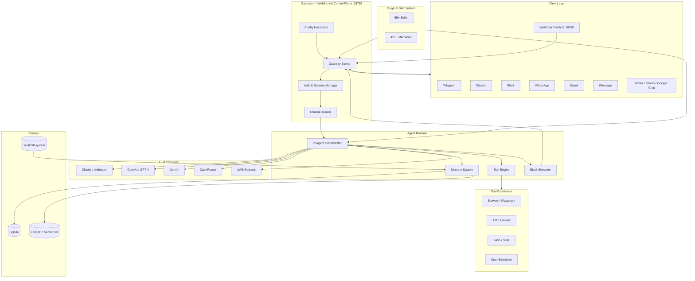
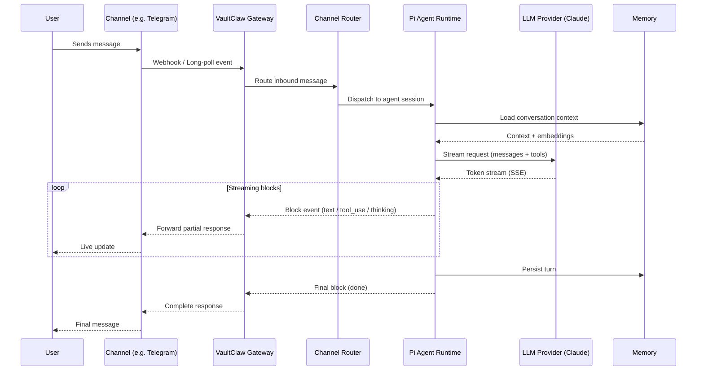

# VaultClaw

**Your AI. Your hardware. Your rules.**

VaultClaw is a self-hosted, single-user AI gateway that connects your preferred large language models to every messaging platform you use — Telegram, Discord, Slack, WhatsApp, iMessage, Signal, and more — while keeping your data, your keys, and your conversations entirely under your control.

[](LICENSE)
[](https://nodejs.org)
[](https://www.typescriptlang.org)
[](docker-compose.yml)
[](https://pnpm.io)

---

## Table of Contents

- [What is VaultClaw?](#what-is-vaultclaw)
- [Why This System — A Builder's Perspective](#why-this-system--a-builders-perspective)
- [System Architecture](#system-architecture)
- [Message Flow](#message-flow)
- [Features](#features)
- [Quick Start](#quick-start)
- [Docker Setup](#docker-setup)
- [Configuration Reference](#configuration-reference)
- [Channel Setup](#channel-setup)
- [Plugin and Skill System](#plugin-and-skill-system)
- [Security Model](#security-model)
- [Deployment Options](#deployment-options)
- [Development](#development)
- [Tech Stack](#tech-stack)
- [Contributing](#contributing)
- [License](#license)

---

## What is VaultClaw?

VaultClaw is a **personal AI operating system** — not a SaaS product, not a hosted service, not another wrapper around ChatGPT.

It runs as a persistent daemon on your own machine (or a server you own), exposing a WebSocket gateway that:

1. Accepts messages from any supported messaging channel
2. Routes them to an AI agent runtime powered by the model of your choice
3. Streams responses back through the originating channel in real time

You bring your API keys. You own your data. The gateway runs where you run it.

---

## Why This System — A Builder's Perspective

Most "AI assistant" products are vertically integrated SaaS systems where the vendor controls the model, the data, the pricing, and the retention policies. VaultClaw takes the opposite approach — it is a **horizontally composable infrastructure layer** designed by engineers who believe personal AI should be treated like personal infrastructure.

### The Core Design Decisions

**1. Single-user, private-by-default**

Multi-tenant AI platforms require storing your conversation history, your files, your credentials on someone else's servers. VaultClaw's threat model assumes you are the only user. There are no accounts, no cloud sync, no telemetry. The only network calls are the ones you configure: your LLM provider, your messaging channel APIs, your optional tool integrations.

**2. WebSocket gateway as the control plane**

Every channel (Telegram, Discord, Slack...) speaks to the same WebSocket server on port 18789. This is the architectural center of gravity. A single, authenticated WebSocket connection carries:
- Inbound messages from all channels
- Outbound streamed AI responses
- Tool invocations (browser, canvas, bash, cron)
- Session state and configuration changes

Why WebSocket instead of REST? Because AI responses stream. A synchronous HTTP request-response model cannot express "the model is mid-sentence, here is the next token." Streaming is a first-class design requirement, not an afterthought.

**3. Channel abstraction, not channel coupling**

Each messaging platform (Telegram, Discord, iMessage...) has a wildly different API surface, webhook model, authentication scheme, and message format. VaultClaw's channel layer normalizes all of this into a single internal message envelope. Adding a new channel means implementing one adapter — it does not require touching the agent runtime, the gateway, or any other channel.

**4. Plugin/Skill runtime for extensibility without forking**

Skills are first-class extension points. A skill is a self-contained module that can expose new CLI commands, new agent tools, new channel handlers, or new configuration schemas. The runtime loads them dynamically. You can add a skill for Obsidian notes, GitHub, 1Password, Trello, or any other system without modifying core VaultClaw source.

**5. Daemon-native deployment model**

VaultClaw is not designed to be run with `node index.js` in a terminal. It ships with systemd and launchd service manifests, a Docker Compose file with security hardening, and Fly.io/Render deployment configs. The first-class deployment target is "always running, self-restarting, monitored process" — the same model you would use for nginx, PostgreSQL, or any other personal infrastructure.

**6. Streaming-first agent protocol**

The Pi agent runtime streams at the block level (not just the token level). This means tool invocations, intermediate thinking steps, and partial responses are all streamed to the client in real time. The UI and channel adapters receive and render these blocks progressively. This is architecturally harder than buffering the full response, but it makes the system feel orders of magnitude more responsive.

**7. Model-agnostic by design**

VaultClaw does not bet on one model or one provider. It speaks to Claude, GPT-4, Gemini, Mistral (via OpenRouter), and AWS Bedrock through a unified provider interface. You can switch models per session, per channel, or per skill. When a model goes down or rate-limits you, the system can failover to another auth profile automatically.

---

## System Architecture



---

## Message Flow



---

## Features

### Messaging Channels

| Channel | Status | Notes |
|---------|--------|-------|
| Telegram | Stable | Bot API, DM + groups |
| Discord | Stable | Bot, slash commands, DM |
| Slack | Stable | Bolt framework, workspace app |
| WhatsApp | Stable | Baileys web client |
| Signal | Stable | signal-cli bridge |
| iMessage | Stable | BlueBubbles / macOS |
| Matrix | Extension | Via matrix extension |
| Microsoft Teams | Extension | Via msteams extension |
| Google Chat | Extension | Webhook integration |
| Mattermost | Stable | Bot token |
| Zalo | Extension | Vietnam platform |
| Twitch | Stable | Chat bot |
| Line | Stable | Messaging API |
| WebChat | Built-in | Browser UI on :18790 |

### LLM Providers

| Provider | Models |
|----------|--------|
| Anthropic | Claude Opus 4.6, Sonnet 4.6, Haiku 4.5, all legacy |
| OpenAI | GPT-4o, GPT-4-turbo, o1, o3 |
| Google | Gemini 2.0 Flash, Gemini 1.5 Pro |
| OpenRouter | 100+ models via unified API |
| AWS Bedrock | Claude, Llama, Titan, Mistral |
| ZAI / AI Gateway | Custom routing layers |

### Platform Support

| Platform | Support |
|----------|---------|
| macOS | Native app + daemon (launchd) |
| Linux | Daemon (systemd) + Docker |
| iOS | Native companion app |
| Android | Companion app |
| Docker | Production-grade compose |
| Fly.io | One-command deploy |
| Render | One-click deploy |

### Built-in Tools

- **Browser automation** — Playwright-powered headless browsing, screenshots, web scraping
- **Canvas rendering** — A2UI live canvas for rich visual output
- **Bash execution** — Shell commands within sandboxed sessions
- **Cron scheduler** — Recurring tasks and reminders
- **Voice** — ElevenLabs TTS + Deepgram STT
- **Memory** — Persistent vector search with SQLite and LanceDB
- **File I/O** — PDF parsing, image processing, media pipeline

---

## Quick Start

### Prerequisites

- Node.js 22 or higher
- pnpm 10+ (`npm install -g pnpm`)
- An API key for at least one LLM provider (e.g. `ANTHROPIC_API_KEY`)
- A bot token for at least one messaging channel (e.g. Telegram)

### Install

```bash
# From npm (recommended)
npm install -g vaultclaw

# Or with pnpm
pnpm add -g vaultclaw

# Or with bun
bun add -g vaultclaw
```

### Onboard

The interactive wizard walks you through everything:

```bash
vaultclaw onboard
```

This will:
1. Set your LLM provider and API key
2. Configure a messaging channel
3. Set a gateway auth token
4. Write `~/.vaultclaw/vaultclaw.json` and `~/.vaultclaw/.env`

### Start the gateway

```bash
vaultclaw gateway
```

The gateway starts on port 18789 (WebSocket) and 18790 (Web UI). Open `http://localhost:18790` to access the control panel.

### Send a message

```bash
# Send a one-shot message via the agent
vaultclaw send "What is the current time in Tokyo?"

# Or use the terminal UI
vaultclaw tui
```

---

## Docker Setup

The cleanest way to run VaultClaw persistently.

### 1. Copy the environment file

```bash
cp .env.example .env
```

Edit `.env` and fill in:
- `VAULTCLAW_GATEWAY_TOKEN` — a long random token (`openssl rand -hex 32`)
- `ANTHROPIC_API_KEY` (or another LLM provider key)
- Your channel tokens (Telegram, Discord, etc.)

### 2. Create the secrets directory

VaultClaw supports Docker secrets for Claude session credentials:

```bash
mkdir -p secrets
chmod 700 secrets

# Only needed if you use Claude.ai web session auth (optional)
echo "your-session-key" > secrets/claude_ai_session_key.txt
echo "your-web-session-key" > secrets/claude_web_session_key.txt
echo "your-cookie" > secrets/claude_web_cookie.txt
chmod 600 secrets/*.txt
```

### 3. Configure data directory

```bash
mkdir -p data/.vaultclaw data/workspace
```

### 4. Build the image

```bash
# Standard build
docker build -t vaultclaw:local .

# With browser automation support (+~300MB)
docker build --build-arg VAULTCLAW_INSTALL_BROWSER=1 -t vaultclaw:local .
```

Or pull a prebuilt image:

```bash
docker pull ghcr.io/your-org/vaultclaw:latest
```

### 5. Start the stack

```bash
docker compose up -d
```

**Services started:**
- `vaultclaw-gateway` — Gateway server on ports 18789 + 18790
- `vaultclaw-cli` — Interactive CLI (attach with `docker attach`)

**Check status:**

```bash
docker compose ps
docker compose logs -f vaultclaw-gateway
```

**Run CLI commands:**

```bash
docker compose exec vaultclaw-cli node dist/index.js doctor
docker compose exec vaultclaw-cli node dist/index.js send "Hello"
```

### 6. Configure channels

After the gateway is running, configure channels either via:
- Web UI at `http://localhost:18790`
- CLI: `docker compose exec vaultclaw-cli node dist/index.js wizard`
- Editing `data/.vaultclaw/vaultclaw.json` directly

---

## Configuration Reference

VaultClaw uses two configuration layers: environment variables (`.env`) and the JSON config file (`vaultclaw.json`).

### Environment Variables

| Variable | Required | Description |
|----------|----------|-------------|
| `VAULTCLAW_GATEWAY_TOKEN` | Yes (if not loopback) | Auth token for WebSocket connections |
| `VAULTCLAW_GATEWAY_PASSWORD` | No | Alternative to token (use one or the other) |
| `ANTHROPIC_API_KEY` | One required | Anthropic Claude API key |
| `OPENAI_API_KEY` | One required | OpenAI API key |
| `GEMINI_API_KEY` | One required | Google Gemini API key |
| `OPENROUTER_API_KEY` | One required | OpenRouter API key |
| `TELEGRAM_BOT_TOKEN` | Channel | Telegram bot token from @BotFather |
| `DISCORD_BOT_TOKEN` | Channel | Discord bot token |
| `SLACK_BOT_TOKEN` | Channel | Slack xoxb- token |
| `SLACK_APP_TOKEN` | Channel | Slack xapp- socket mode token |
| `VAULTCLAW_STATE_DIR` | No | Override state directory (default: `~/.vaultclaw`) |
| `BRAVE_API_KEY` | No | Brave Search API for web search tool |
| `ELEVENLABS_API_KEY` | No | ElevenLabs for voice synthesis |
| `DEEPGRAM_API_KEY` | No | Deepgram for speech-to-text |

### vaultclaw.json Structure

```jsonc
{
  "gateway": {
    "auth": {
      "token": "your-token-here"
    },
    "bind": "lan"       // "loopback" | "lan" | "0.0.0.0"
  },
  "agents": [
    {
      "name": "main",
      "model": "claude-opus-4-6",
      "provider": "anthropic",
      "systemPrompt": "You are a helpful assistant."
    }
  ],
  "channels": {
    "telegram": {
      "enabled": true,
      "token": "${TELEGRAM_BOT_TOKEN}"
    },
    "discord": {
      "enabled": true,
      "token": "${DISCORD_BOT_TOKEN}"
    }
  }
}
```

---

## Channel Setup

### Telegram

1. Message [@BotFather](https://t.me/BotFather) on Telegram
2. `/newbot` → follow prompts → copy the token
3. Set `TELEGRAM_BOT_TOKEN=<token>` in `.env`
4. Enable in `vaultclaw.json` or via wizard
5. DM your bot to pair (security challenge by default)

### Discord

1. Go to [Discord Developer Portal](https://discord.com/developers/applications)
2. Create application → Bot → copy token
3. Enable Privileged Gateway Intents (Message Content, Server Members)
4. Generate invite URL with `bot` + `applications.commands` scopes
5. Set `DISCORD_BOT_TOKEN=<token>` in `.env`

### Slack

1. Create app at [api.slack.com/apps](https://api.slack.com/apps) with Socket Mode enabled
2. Add OAuth scopes: `chat:write`, `im:history`, `im:read`, `im:write`, `channels:history`
3. Copy **Bot Token** (`xoxb-`) and **App-Level Token** (`xapp-`)
4. Set `SLACK_BOT_TOKEN` and `SLACK_APP_TOKEN` in `.env`

### WhatsApp

1. WhatsApp channel uses the Baileys library (WhatsApp Web protocol)
2. Enable WhatsApp in your config
3. On first run, a QR code will be displayed — scan with your WhatsApp mobile app
4. The session is persisted for future restarts

### iMessage (macOS only)

1. Requires [BlueBubbles](https://bluebubbles.app) server running on your Mac
2. Configure BlueBubbles server URL and password in the iMessage skill settings
3. VaultClaw connects to BlueBubbles as a secondary client

### Signal

1. Requires [signal-cli](https://github.com/AsamK/signal-cli) installed and registered
2. Register your phone number with signal-cli
3. Configure the signal-cli socket path in VaultClaw config

---

## Plugin and Skill System

VaultClaw's capability surface is extended through **Skills** (user-facing modules) and **Extensions** (infrastructure modules).

### Skills (55+ available)

Skills expose new tools and commands to the agent and CLI:

| Category | Examples |
|----------|---------|
| Development | `coding-agent`, `github` |
| Productivity | `apple-notes`, `obsidian`, `trello`, `1password` |
| Communication | `slack`, `discord` |
| Media | `voice-call`, `openai-whisper` |
| UI | `canvas`, `bluebubbles` |

### Extensions (42+ available)

Extensions add infrastructure capabilities:

| Category | Examples |
|----------|---------|
| Channels | `matrix`, `msteams`, `zalo` |
| Memory backends | `memory-core`, `memory-lancedb` |
| Voice | `voice-call`, `talk-voice` |
| LLM orchestration | `llm-task`, `lobster` |
| Auth | Various provider auth extensions |

### Loading a Skill

```bash
# Install a skill to your VaultClaw installation
vaultclaw skill install github

# Or place skills in your state directory
~/.vaultclaw/skills/my-custom-skill/
```

### Writing a Skill

Skills are TypeScript modules that export a manifest:

```typescript
export default {
  name: 'my-skill',
  version: '1.0.0',
  tools: [
    {
      name: 'my_tool',
      description: 'Does something useful',
      inputSchema: { ... },
      execute: async (input) => { ... }
    }
  ]
}
```

See the [plugin SDK documentation](docs/plugins/) for the full API.

---

## Security Model

VaultClaw is built with a defense-in-depth approach.

### Gateway Authentication

- All WebSocket connections require a token or password
- Set `VAULTCLAW_GATEWAY_TOKEN` to a random 256-bit secret
- Generate one: `openssl rand -hex 32`
- Unauthenticated connections are rejected at the handshake layer

### DM Pairing

- Unknown senders are rejected by default (configurable per channel)
- First-time users must be explicitly paired via DM challenge
- Pairing state is persisted in the local config
- Groups can be configured to require @mentions

### Container Hardening

The Docker Compose configuration enforces:

```yaml
security_opt:
  - no-new-privileges:true           # Prevent privilege escalation
  - seccomp:./docker/seccomp-node.json  # Restrict syscalls to Node.js allowlist
cap_drop:
  - ALL                              # Drop all Linux capabilities
read_only: true                      # Read-only root filesystem
tmpfs:
  - /tmp:mode=1777                   # Writable tmpfs for /tmp only
```

### Process Security

- Runs as non-root user `node` (uid 1000) inside containers
- Credentials stored as Docker secrets (mounted as files, not env vars)
- `_FILE` suffix convention: env vars point to secret file paths
- No credentials in environment — secrets are read from mounted files

### Network Security

- Gateway binds to loopback by default (`--bind loopback`)
- Set `--bind lan` for local network access
- SSRF protection on outbound tool requests
- Trust audit log for all channel activity

---

## Deployment Options

### Local Daemon

**macOS (launchd)**

```bash
vaultclaw daemon install --platform macos
vaultclaw daemon start
```

Creates a launchd plist at `~/Library/LaunchAgents/com.vaultclaw.gateway.plist`.

**Linux (systemd)**

```bash
vaultclaw daemon install --platform linux
sudo systemctl enable --now vaultclaw-gateway
```

### Docker Compose

See [Docker Setup](#docker-setup) above. Best for running on a home server, NAS, or VPS.

### Fly.io

```bash
fly launch --config fly.toml
fly secrets set VAULTCLAW_GATEWAY_TOKEN=$(openssl rand -hex 32)
fly secrets set ANTHROPIC_API_KEY=sk-ant-...
fly deploy
```

The included `fly.toml` configures:
- 2 shared CPUs, 2GB RAM
- Persistent volume at `/data`
- Health check on `/health`

### Render

Click **Deploy to Render** (add badge once repo is public), or:

```bash
# render.yaml is already configured
# Set env vars in Render dashboard after first deploy
```

---

## Development

### Prerequisites

- Node.js 22+
- pnpm 10+ (`npm install -g pnpm`)
- Bun (optional, used for some build scripts): `curl -fsSL https://bun.sh/install | bash`

### Setup

```bash
git clone https://github.com/your-org/vaultclaw.git
cd vaultclaw
pnpm install
```

### Build

```bash
# Build TypeScript source
pnpm build

# Build the Web UI (Vite)
pnpm ui:build

# Build everything
pnpm build && pnpm ui:build
```

### Run in development

```bash
# Start gateway with live TypeScript execution
pnpm dev gateway

# Or watch-compile and restart on changes
pnpm gateway:watch
```

### Testing

```bash
# Unit tests
pnpm test

# End-to-end tests
pnpm test:e2e

# Live provider tests (requires real API keys)
pnpm test:live

# Type check only
pnpm typecheck
```

### Linting and formatting

```bash
# Lint (Oxlint — Rust-based, very fast)
pnpm lint

# Format (Oxfmt)
pnpm fmt

# Both
pnpm lint && pnpm fmt
```

### Project Structure

```
vaultclaw/
├── src/
│   ├── agents/          # Pi agent orchestration runtime
│   ├── gateway/         # WebSocket control plane server
│   ├── channels/        # Channel abstraction + routing
│   ├── cli/             # CLI argument parsing + UI
│   ├── commands/        # Command implementations
│   ├── config/          # Config loading and validation
│   ├── memory/          # Memory and vector search
│   ├── security/        # Auth and trust management
│   ├── plugins/         # Plugin runtime loader
│   ├── plugin-sdk/      # SDK for writing plugins/skills
│   ├── providers/       # LLM provider adapters
│   ├── tui/             # Terminal UI
│   ├── web/             # Web UI components
│   └── daemon/          # Systemd/launchd daemon management
├── extensions/          # 42+ infrastructure extensions
├── skills/              # 55+ user-facing skill modules
├── ui/                  # Vite + Lit web control panel
├── apps/
│   ├── macos/           # Swift macOS native app
│   ├── ios/             # Swift iOS companion app
│   └── android/         # Android companion app
├── docs/                # Mintlify documentation
├── scripts/             # Build, Docker, deployment scripts
└── test/                # Test fixtures, helpers, mocks
```

---

## Tech Stack

| Layer | Technology |
|-------|-----------|
| Runtime | Node.js 22 (ESM) |
| Language | TypeScript 5.9 |
| CLI | Commander |
| Gateway | Express 5 + WebSocket |
| Web UI | Vite + Lit 3.3 (web components) |
| Agent | Pi Agent framework |
| Browser | Playwright Core |
| Discord | discord.js |
| Telegram | grammY |
| Slack | @slack/bolt |
| WhatsApp | Baileys |
| Validation | Zod 4 + TypeBox |
| Storage | SQLite + sqlite-vec + LanceDB |
| Testing | Vitest 4 |
| Linting | Oxlint (Rust) |
| Formatting | Oxfmt |
| Package manager | pnpm 10 |
| Build | tsdown + Rolldown |
| Containerization | Docker + Compose |

---

## Contributing

Contributions are welcome. Please read [CONTRIBUTING.md](CONTRIBUTING.md) before submitting a pull request.

Key areas where contributions are most valuable:
- New channel adapters
- New skills and extensions
- LLM provider integrations
- Documentation improvements
- Bug fixes and test coverage

---

## License

MIT — see [LICENSE](LICENSE) for full text.

---

*Built for people who believe personal AI should run on personal infrastructure.*
